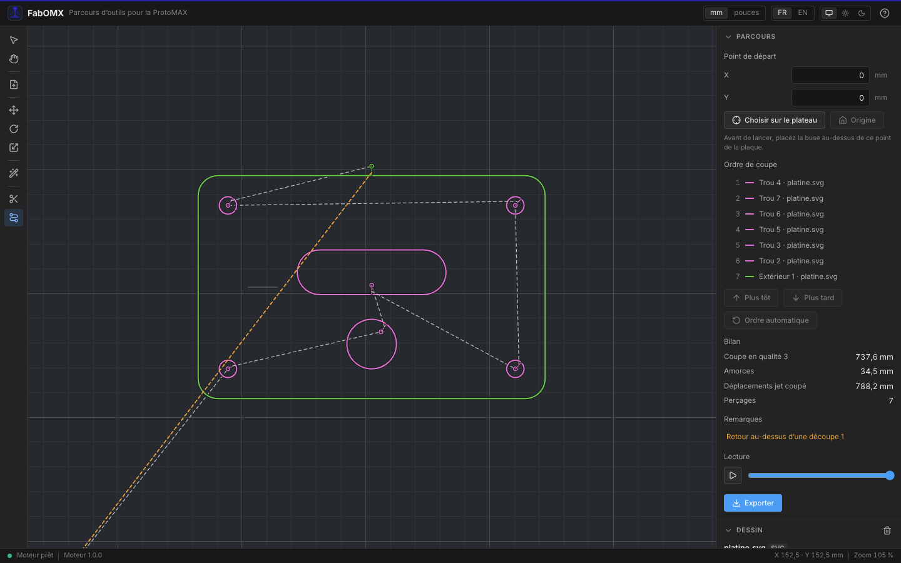
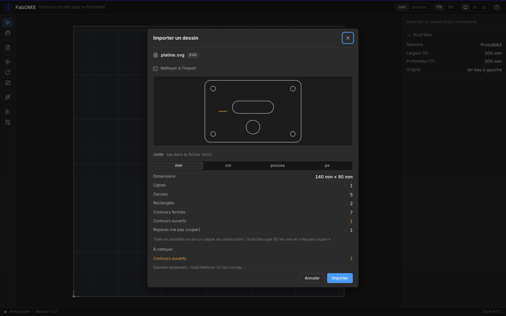
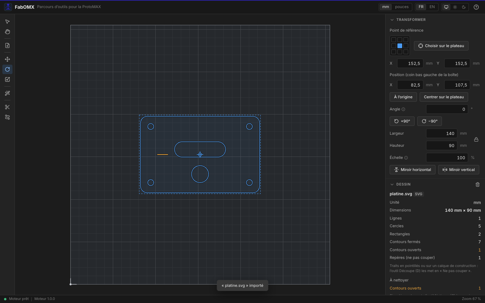
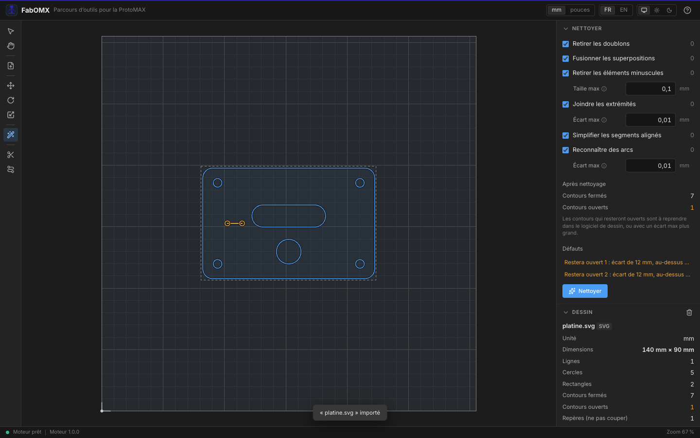
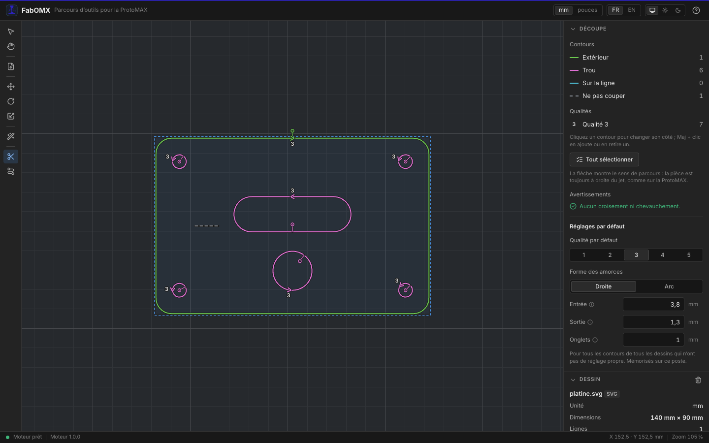

# FabOMX

Parcours d’outils pour la ProtoMAX.

FabOMX transforme un dessin vectoriel (SVG ou DXF) en fichier OMX pour la découpeuse jet d’eau **ProtoMAX** d’OMAX : il le place sur le plateau, le nettoie, règle la découpe (côtés, qualités, amorces, onglets), calcule le parcours et l’écrit dans le format de LAYOUT, que **MAKE** ouvre tel quel. Application de la famille Fab, pour Mac et Windows, en français et en anglais.



Version 1.0.0 : voir le [journal des versions](CHANGELOG.md). État détaillé : [STATUS.md](STATUS.md) ; feuille de route : [ROADMAP.md](ROADMAP.md).

## Installer

Télécharger la dernière version sur la page [Releases](https://github.com/harry-finch/FabOMX/releases).

- **Mac** (Apple Silicon) : ouvrir le `.dmg` et glisser FabOMX dans Applications. L’application n’a pas de signature payante : **la première fois**, clic droit sur FabOMX, puis **Ouvrir**, et confirmer.
- **Windows** : lancer l’installateur `.exe`. Windows SmartScreen peut avertir d’un éditeur inconnu : **Informations complémentaires**, puis **Exécuter quand même**.

## Utiliser FabOMX

Les raccourcis s’affichent avec ⌘ sur Mac et Ctrl sous Windows ; la touche **?** les liste tous.

### 1. Importer le dessin

**Importer** (I, ou ⌘O, ou glisser le fichier sur la fenêtre). Le dialogue montre le dessin, son unité (à corriger si le fichier n’en dit rien), ses dimensions, ce qu’il faudra nettoyer et les avertissements. Les courbes deviennent des arcs à 0,01 mm près ; « Nettoyer à l’import » nettoie dès maintenant.



### 2. Le placer sur le plateau

Le dessin arrive au centre du plateau de la ProtoMAX (305 × 305 mm, origine en bas à gauche). Le glisser avec l’outil Sélection (V), le tourner (R), le mettre à l’échelle (S) ou le retourner, à la souris ou par valeurs dans le panneau de droite, autour d’un point de référence au choix. Les flèches du clavier le décalent de 1 mm (10 mm avec Maj).



### 3. Le nettoyer

Outil **Nettoyer** (C) : doublons, superpositions, éléments minuscules, extrémités presque jointes, segments alignés, arcs dans les polylignes. Chaque opération dit combien de corrections elle fera ; les défauts restants sont listés et situés. Rien n’est inventé : un contour qui ne se ferme pas reste ouvert et signalé.



### 4. Régler la découpe

Outil **Découpe** (D). Chaque contour a un côté, détecté par imbrication : **extérieur** (la pièce est dedans), **trou**, **sur la ligne** (fente) ou **ne pas couper** (repère). La flèche montre le sens : la pièce est toujours à droite du jet, comme sur la machine. Un clic choisit un contour (Maj + clic en ajoute, ⌘A les prend tous) pour changer :

- son côté, et pour un tracé ouvert le côté de la pièce (les hachures marquent la chute) ;
- sa **qualité** de 1 (rapide) à 5 (net) ;
- ses **amorces** (droites ou en arc, longueurs) et son point d’entrée ;
- ses **onglets**, qui gardent la pièce accrochée à la plaque.

Les réglages par défaut sont en bas de la section.



### 5. Vérifier le parcours

Outil **Parcours** (P) : l’ordre de coupe (les trous avant l’extérieur de leur pièce, puis le perçage le plus proche), les déplacements jet coupé en pointillés, le bilan et la lecture pas à pas. L’ordre se retouche avec **Plus tôt** et **Plus tard** ; un ordre dangereux est refusé.

Le **point de départ** est l’endroit où la buse se trouve quand on lance la coupe : le choisir sur le plateau (un coin de la plaque, un point du dessin) ou par ses coordonnées.

### 6. Exporter et couper

**Exporter** écrit le fichier `.omx`. S’il reste des remarques (débord du plateau, croisements, amorces trop courtes…), elles sont listées avant. Dans MAKE, ouvrir le fichier, **placer la buse au-dessus du point de départ** sur la plaque, puis lancer la coupe : MAKE compense la saignée du côté indiqué par FabOMX.

### Enregistrer un travail

**Enregistrer** (⌘S) écrit un fichier `.fabomx` autonome : les dessins (nettoyages compris), leur placement, les réglages de découpe faits à la main, le point de départ et l’ordre. Il se rouvre par **Ouvrir** (⌘O), par dépôt sur la fenêtre ou depuis les fichiers récents, même si les SVG ou DXF d’origine ont bougé. **Nouveau travail** : ⌘N.

## Développer

Prérequis : Rust (version fixée par `rust-toolchain.toml`), [wasm-pack](https://wasm-bindgen.github.io/wasm-pack/), Node.js.

```sh
cd ui
npm install
npm run wasm      # compile le moteur en WebAssembly
npm run dev       # http://localhost:5177
npm run desktop   # application Mac : dist-desktop/FabOMX.app
```

Vérifications (aussi lancées par GitHub Actions à chaque poussée) :

```sh
cargo test --workspace
cargo clippy --workspace --all-targets
cd ui && npm run check
```

**Releases** : pousser une étiquette `vX.Y.Z` lance le flux `.github/workflows/release.yml`, qui construit l’application Mac (`.dmg`) et l’installateur Windows (`.exe`) et les joint à un brouillon de release, avec les notes du [CHANGELOG](CHANGELOG.md). Il reste à relire et publier le brouillon.

Consignes de développement : [AGENTS.md](AGENTS.md).

## Organisation

| Dossier | Rôle |
| --- | --- |
| `crates/fabomx-core` | Moteur pur : géométrie, import SVG et DXF, nettoyage, côtés, amorces, onglets, parcours, OMX |
| `crates/fabomx-wasm` | Le moteur compilé en WebAssembly pour l’interface |
| `crates/fabomx-desktop` | Application de bureau Tauri, Mac et Windows (hors du workspace Cargo) |
| `ui/` | Interface Svelte 5 (kit `fab-design-system`) |
| `omx/` | Exemples DXF + OMX produits par LAYOUT, référence du format |
| `branding/` | Logo et planche de choix |
| `docs/images/` | Captures du guide |
| `roadmap/` | Feuille de route lue par FabBoard |

## Licence

GPL-3.0-or-later, comme FabVents, FabSpeed et FabCAM. Voir [LICENSE](LICENSE).
